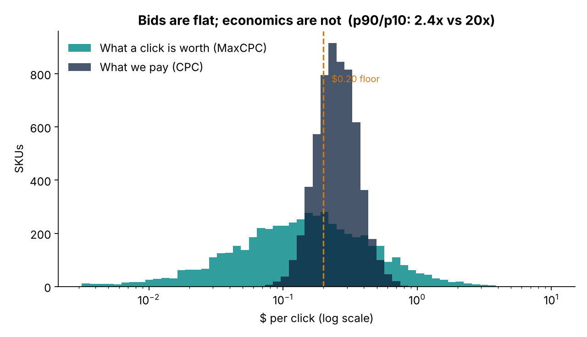
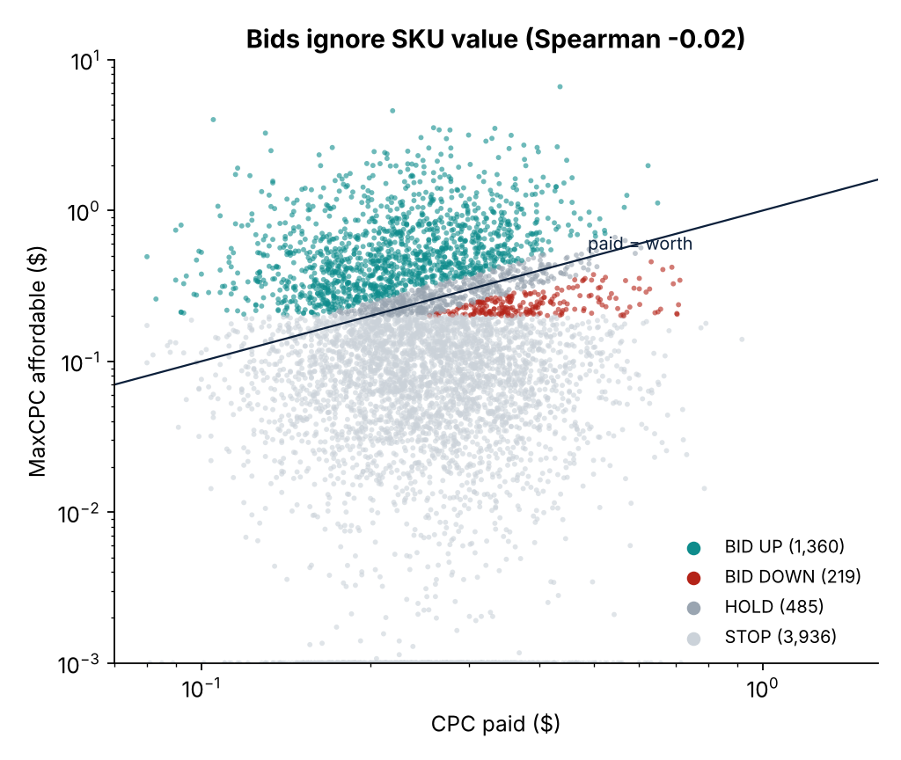
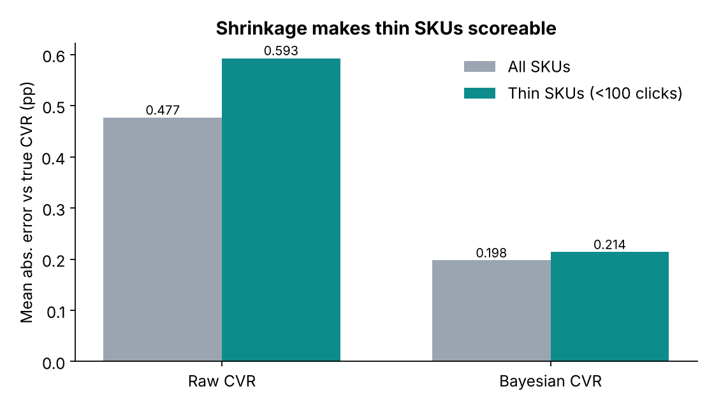
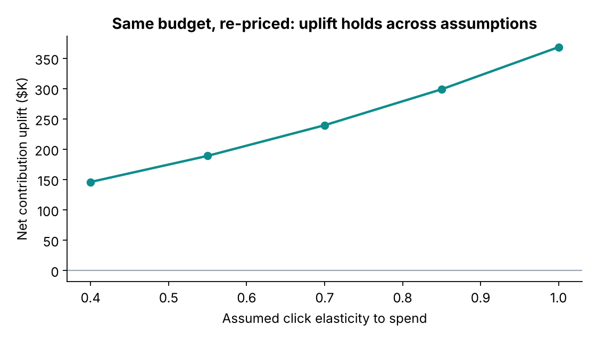

# Bayesian bid pricing: price every ad click from SKU economics

> **Are we bidding too low?** Usually the wrong question. On a large catalogue, the problem is that bids are **flat** while what a click is worth varies by an order of magnitude.

This repo is a clean-room rebuild, **on fully synthetic data**, of a method I developed for a large-item furniture marketplace advertising tens of thousands of SKUs on Amazon. On the real catalogue, the analysis found:

- what a click was worth varied **16x** across SKUs (p90/p10), while what we paid varied **under 3x**
- CPC paid had essentially **no correlation** with SKU value (Spearman +0.12)
- re-pricing the same budget was worth **~$450K contribution per quarter** (modelled), and the method fed a staged bid test and Prime Day campaign selection

No company data or code is included. The synthetic generator reproduces the *shape* of the problem so the method can be run, inspected and challenged end to end.



## The method

| Step | What | Why |
|---|---|---|
| 1 | **Bayesian CVR:** `(orders + k·cohort_cvr) / (clicks + k)`, k = 300 clicks | Scores *every* SKU. A minimum-order cutoff would only score products that already sell, which excludes every growth candidate. Zero-order SKUs with many clicks are pulled *below* their cohort. |
| 2 | **MaxCPC** = `CVR_bayes × contribution per unit` | The breakeven price of a click. Contribution is measured *before* marketing. |
| 3 | **Ratio** = `MaxCPC / CPC paid` | Above 1 means we can afford more than we pay. |
| 4 | **Verdict:** BID UP / BID DOWN / HOLD / STOP | STOP when MaxCPC is under the practical ~$0.20 CPC floor: those SKUs can only be paused, not bid down. BID UP is staged by how much of the CVR is the SKU's own evidence. |
| 5 | **Constant-budget reallocation**, swept across click-elasticity assumptions | Volume response is assumed, not observed, so the result is reported as a range. Hence a bounded test before scaling. |

Every scored row includes a `why` column with its arithmetic in words, e.g.:

```
3087 clicks, 19 orders (own CVR 0.62%); category 0.26%; blended 0.58% at 91% own-evidence.
$444/unit -> MaxCPC $2.59 vs paid $0.25 (ratio 10.21) -> BID UP.
```

## Results on the synthetic catalogue (6,000 SKUs)

| | p10 | median | p90 | p90/p10 |
|---|---|---|---|---|
| CPC paid | $0.16 | $0.25 | $0.39 | **2.4x** |
| MaxCPC affordable | $0.03 | $0.14 | $0.58 | **19.5x** |

- Spearman(CPC paid, MaxCPC) ≈ **0.0**: bids ignore value
- Shrinkage cuts conversion-rate error on thin SKUs (<100 clicks) by **~64%** (0.59 → 0.21 percentage points)
- Verdicts: 1,360 bid up · 219 bid down · 485 hold · 3,936 stop
- Same budget, re-priced: net contribution moves from about −$11K to **+$135K to +$357K** depending on elasticity (0.4–1.0). About $100K of freed budget has no profitable home in the current ad pool, which points to never-advertised SKUs as the next step.

<p float="left">


</p>



## What's deliberately *not* claimed
- **Halo sales are excluded.** Halo incrementality is unmeasured without a holdout. The real analysis reported the *breakeven* incrementality (38%) instead of assuming one.
- **Price, not volume.** Without impression-share data, extra click volume is scenario-modelled via elasticity.
- **Thin SKUs lean on their category.** That's why BID UP is staged by evidence weight rather than applied all at once.

## Run it

```bash
pip install -r requirements.txt
python run_demo.py          # writes data/, figures/, prints summary tables
pytest -q                   # 4 tests incl. a hand-checked shrinkage example
```

Or open [`notebooks/walkthrough.ipynb`](notebooks/walkthrough.ipynb) for the narrated version.

```
src/bidpricing/
  simulate.py   synthetic catalogue (economics, true CVR, flat bids)
  model.py      Bayesian CVR, MaxCPC, verdicts, dispersion, estimator error
  allocate.py   constant-budget reallocation + elasticity sweep
run_demo.py     end-to-end pipeline and figures
tests/          unit tests
```

---
**Amrisha Rajkhowa** · Product & analytics leader · [LinkedIn](https://ca.linkedin.com/in/amrisha-rajkhowa-ubc)
